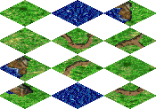

# CamSys news archive - November 2001

{{begin-newsitem |time=2001-12-01T03:50:00Z |title=Progress Report #1 |author=Otak |site=Camsys |categories=Camsys}}
It's been over a month since I last told you my progress on L2Edit, and it's about time I posted an update for you. In my last post, I think I was somewhere around deciphering the palettes; I've completed that, and have deciphered somewhere around 170 tiles, and have them in *.bmp form. Here's a pic of some random tiles:

170 tiles might sound a lot to some of you, but there are countless more to do, I'm averaging about 30-40 a day but I don't have time to do this everyday. For the last week or so my schedule has been something like: School(8:10-2:45), Track(3:15-5:15), Nap(~5:30-9:00), Homework, Sleep. So I'm really looking forward to this weekend, and maybe I'll get more work done, but as for tonight it's not looking too good.

{{highlight |text=Veldhar[GD]}}, as some of you know, is working on a new layout for the site. I'm not supposed to give any details, but come to the [chatroom](/web/20011202192439/http://www.camsys.org/chat/chatroom.shtml) around 9:30-11:30PM EST and maybe {{highlight |text=Veldhar[GD]}} will tell you some more than I can.

Until the next update..
{{end-newsitem}}

{{begin-newsitem |time=2001-11-24T23:08:00Z |title=What?  You think I actually do stuff? |author=Langweilig |site=Camsys |categories=Camsys}}
Hey, it's been a while since I posted anything so I decided I should update y'all.  First off, I've been *extremely* busy with College applications/essays/vists/etc.  It looks like this, coupled with a few other factors, will basically keep me busy for the next month.  However, I have been working on *something*.  I've been messing around with the Empire Earth demo, and I think I've got a lot of it figured out.  It looks like the release version will be EXTREMELY similar (filewise), so it shouldn't be that hard once I get my hands on a copy to start making modding stuff.  HOWEVER, I cannot get a copy of Empire Earth until Christmas because all my money is being spent on car repairs =\  So, quick synopsis, I will be doing something but not for the next month.  Ciao!
{{end-newsitem}}
