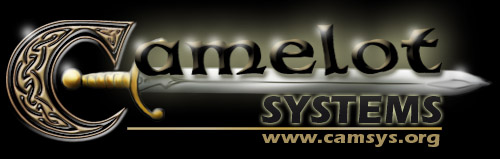

# CamSys news archive - January 2003

{{begin-newsitem |time=2003-01-24T01:25:13Z |title=Camelot Systems - R.I.P. 1998-2002 |author=Veldhar[GD] |site=Camsys |categories=Camsys}}

R.I.P

1998-2002

In July 2002, Camelot Systems accepted its fate and unofficially announced its death, while leaving its existing website and resources online to be used by those still having a need for it.

However, due to the ingratitude and irrespect of many, it has been considered that Camelot Systems was no longer worth maintaining and being kept online. No, it shall not serve as a publicity stand for organizations that were founded by the very same people that bashed Camelot Systems and its staff with the utmost inconsideration of the time and efforts that were put just to serve them better, and the incomprehension that Camelot Systems had done its time, and that nothing else could be done to save it after the numerous attempts that were made to do so.

Nonetheless, I would like to address our sincere thanks to everyone who supported us through our ups and downs. I would also like to thank our friends that helped us during all these years, doing the best of what could be done for the community. Camelot Systems probably wouldn't have made it if it wasn't for our pleasure of providing game customization software and services for persons that enjoyed them even more than we had making them. There's probably too many of these persons to even bother making a list; and these persons already know who they are. Many thanks again, it's been a really fun time.

Many thanks as well to our formidable host, [ReconGamer](https://web.archive.org/web/20030124012513/http://www.recongamer.com/), who provided us great hosting services that allowed us to live longer, and not die abruptedly without explanations, two years ago.

As for the other ones I've mentioned above... You also know who you are. I hope you realize one day that there is real persons behind the names you see on the net, and being that inconsiderate of your sayings and actions actually does harm, just as in Real Life(tm).

Farewell...
- Veldhar Windrider, aka: Gold Dragon
Former leader of Camelot Systems
{{end-newsitem}}
